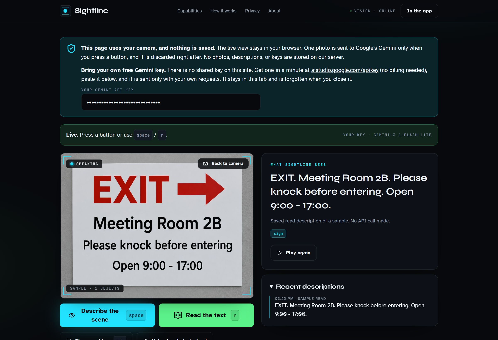
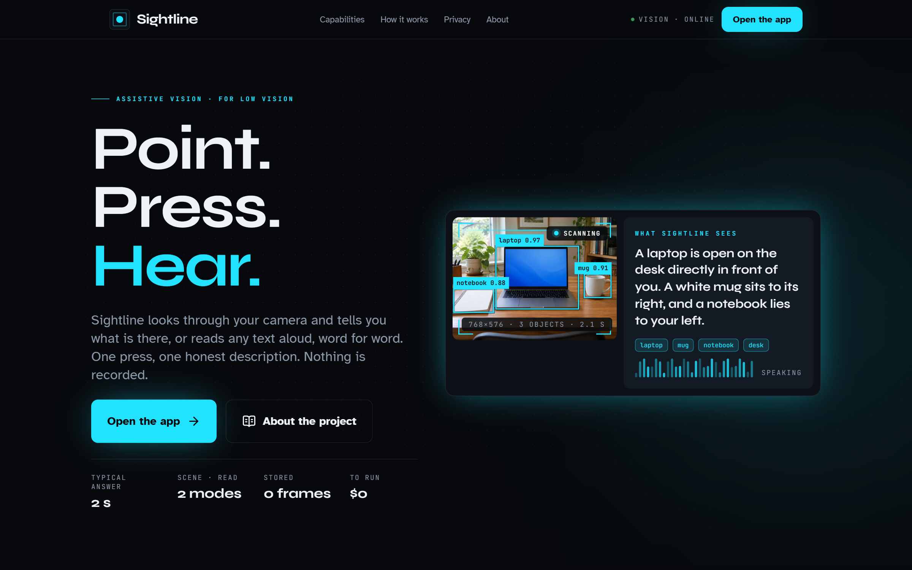
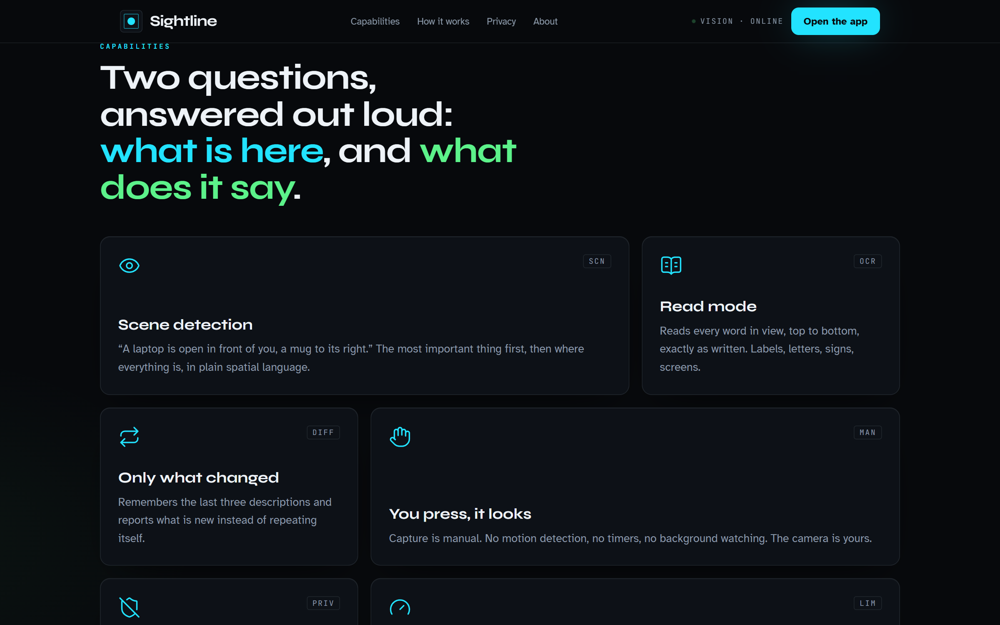
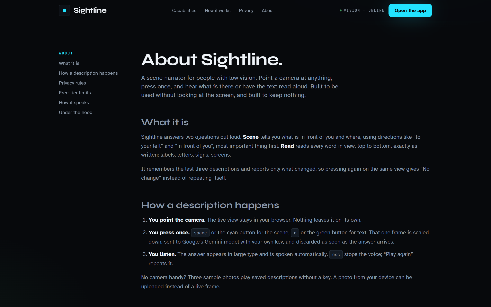
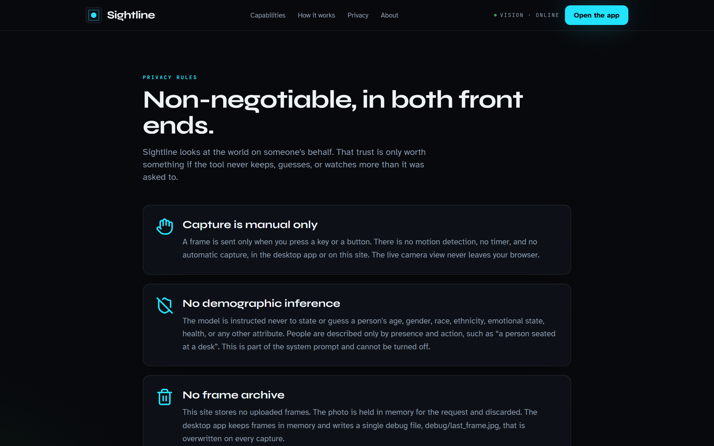
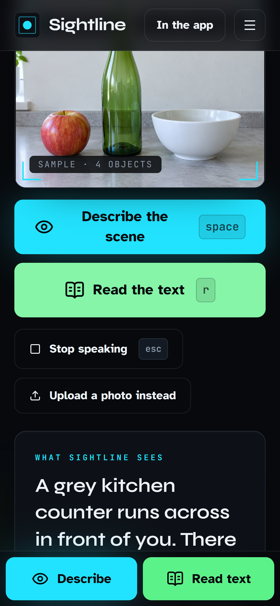
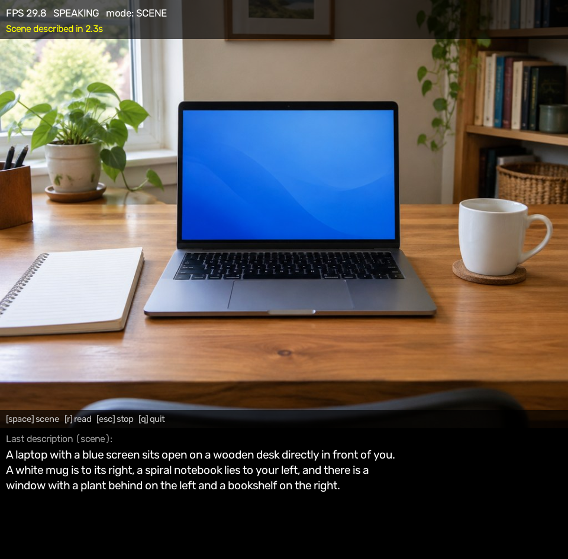

<div align="center">

# 👁️ Sightline

### Hear what your camera sees.

**A webcam scene narrator for people with low vision.**
One press describes what is in front of you, or reads any visible text aloud, word for word.

[**Live demo**](https://sightline-rho-khaki.vercel.app) · [How it works](#how-it-works) · [Run it yourself](#run-it-yourself) · [Privacy](#privacy-by-design)

[](https://sightline-rho-khaki.vercel.app)


[](LICENSE)

<br/>

Created by **Ali Hadi Meselmani**

[](https://www.linkedin.com/in/alihadimeselmani)
[](https://github.com/AliHadi315)

<br/>

<a href="https://sightline-rho-khaki.vercel.app/app">
  
</a>

</div>

---

Sightline is built for someone who cannot see the screen and wants to know what is on the desk,
what a sign says, or whether the room has changed. Everything it finds is spoken aloud, in plain
language, with directions like *"to your left"* and *"in front of you"*.

## Screenshots

| | |
|---|---|
|  |  |
|  |  |
|  |  |

The desktop window is rendered by the app's own drawing code from a sample frame, so it shows exactly what the camera window looks like without exposing a real camera feed.

## Highlights

| | |
|---|---|
| 🔎 **Scene mode** | "A laptop is open in front of you, a mug to its right." The most important thing first, then layout and what is happening. |
| 📖 **Read mode** | Reads every word in view, top to bottom, exactly as written. Labels, letters, signs, screens. |
| 🔁 **Only what changed** | Remembers the last three descriptions and reports what is new instead of repeating itself. |
| ✋ **Manual capture only** | Nothing is sent until you press a key or a button. No motion detection, no timers, no background watching. |
| 🛡️ **No guessing about people** | Never age, gender, race, or mood. A person is described only by presence and action. |
| ⚡ **Fast and resilient** | Fastest free Gemini Flash model with automatic fallback, text shown the moment it arrives, speech streamed as it is generated. |
| 💸 **Runs on free tiers** | Google AI Studio key, edge-tts speech, Vercel Hobby hosting. No billing account, ever. |

## How it works

1. **Point the camera.** The live view stays in your browser or on your desktop.
2. **Press once.** `space` describes the scene, `r` reads the text. That single frame goes to the model and is forgotten.
3. **Listen.** The answer appears in large type and is spoken automatically. `esc` stops the voice.

Three front ends share one core (`vision.py`, `speech.py`, `memory.py`): a desktop app with a live
camera window, a Gradio interface, and a React website backed by a stateless API that runs as a
serverless function on Vercel.

## Privacy, by design

- **Capture is manual only.** A description happens when you press a key or a button. There is no
  motion detection, no timer, no automatic capture, in either the desktop app or the web demo.
- **No demographic inference.** The model is instructed never to state or guess age, gender, race,
  emotion, health, or any other attribute of a person. People are described only by presence and
  action: "a person seated at a desk".
- **No frame archive.** The desktop app keeps frames in memory and writes only `debug/last_frame.jpg`,
  overwritten on every capture. The web demo writes no frames at all and forgets your API key when the
  request finishes.

## Free-tier limits and what the app does at them

The AI Studio free tier allows roughly 10 to 15 requests per minute and a few hundred per day on
Flash models. Sightline is built to hit those limits gracefully:

- A **3-second cooldown** between triggers, shown on screen.
- On a **429 rate limit**, the call is retried with exponential backoff (1 s, then 2 s) on the
  fallback models. If it still fails, the app says "Rate limit reached, try again in a moment".
- On **503 / 504 overload or a hung request** (15-second timeout), the call switches to the next
  model immediately instead of waiting, so a bad day at Google costs seconds, not a minute.
- When the **daily quota** is exhausted, the desktop app shows a persistent red banner and stops
  calling Gemini; the web demo switches to demo mode.
- A **malformed response** is never fatal: it degrades to a best-effort description or "No change".
- If the description is empty or nearly identical to the previous one, speech is skipped and the app
  shows **No change**.

## Speech: a three-step chain

1. [`edge-tts`](https://github.com/rany2/edge-tts), an unofficial client for Microsoft Edge's Read
   Aloud service. Best voice, streams as it synthesizes, but Microsoft does not support it and can
   block it at any time (it did, with a 403, in October 2026).
2. **Gemini TTS** (`GEMINI_TTS_MODELS` in `config.py`) on the same free AI Studio key, used when
   edge-tts produces no audio. About four seconds per description, returned as WAV. The free tier
   allows only about 10 TTS requests per day and 3 per minute per model, so two models are tried in
   turn; treat this as a thin safety net, not a daily driver.
3. On the website only, **the browser's own voice** (Web Speech API) when the server returns no
   audio at all. Needs no network and cannot go down; the result note says when it was used.

Every step is wrapped: the description is always shown as text, whatever the voices do. If
edge-tts breaks, `pip install -U edge-tts` usually fixes it within days of Microsoft's change.

## Security

- **No secrets in the browser.** The site ships no key; each visitor's key travels only inside their own
  requests and is never logged. Locally, the key comes from `.env` through `config.py`.
- **Rate limiting.** The API counts requests per client IP over a one-minute window in memory
  (describe 20, speak 40, key check 10, anything else 120) and answers 429 with a plain message.
  On serverless each warm instance counts separately, so this is a brake on hammering, not a quota.
- **Security headers** in `vercel.json`: a Content-Security-Policy that allows only the site's own
  scripts, Google Fonts styles, blob audio and data-URI images; `frame-ancestors 'none'`; nosniff;
  a Permissions-Policy that grants the camera to the site only; HSTS. The local server applies the
  same headers from the same file so the policy can be tested before a deploy.
- **Inputs.** Uploads go through Pillow with its decompression-bomb limit, sample names are
  whitelisted, history JSON is parsed defensively, spoken text is capped at 1,500 characters, and
  every handler returns a plain message instead of a traceback.
- **No cookies, no tracking.** Nothing to consent to, so there is no cookie banner. The privacy page
  carries a short formal policy and the terms page a plain-language disclaimer.

## Run it yourself

Everything a developer needs lives in the block below: setup, the desktop app and its hotkeys, local
website development, the Gradio interface, the eval harness, logging, and the file layout. Visitors
who only want to use Sightline can stop here and open the [live site](https://sightline-rho-khaki.vercel.app).

<details>
<summary><strong>Open the developer guide</strong></summary>

### Setup

Everything runs on free tiers: a free Google AI Studio key, free `edge-tts` speech, free Vercel
hosting. No billing account is ever needed.

1. **Get a free Gemini key.** Go to <https://aistudio.google.com/apikey>, sign in with a Google
   account, click *Create API key*. Do not enable Google Cloud Billing and do not use Vertex AI.
2. **Install.**

   ```bash
   python -m venv venv
   venv\Scripts\activate          # Windows;  source venv/bin/activate on macOS / Linux
   pip install -r requirements-desktop.txt   # core + desktop app + Gradio + local server
   ```

   `requirements.txt` alone is the slim set (Gemini, edge-tts, Pillow, FastAPI) that the Vercel
   serverless function installs.

3. **Configure.** Copy `.env.example` to `.env` and paste your key after `GEMINI_API_KEY=`.

The Gemini model is a single constant, `MODEL` in `config.py` (currently `gemini-3.1-flash-lite`,
the fastest free-tier vision model, about 2 s per frame when Google is not congested). If it is
overloaded, hangs, or is rate limited, the call switches automatically to the models in
`FALLBACK_MODELS`; the model actually used is recorded in each log line and API response.
Gemini 1.5 is retired for new keys; keep these on current Flash models.

### Desktop app

```bash
python main.py
```

A window shows the live camera with an FPS counter, the current state
(`IDLE / CAPTURING / THINKING / SPEAKING`), the active mode, and the cooldown timer.

| Key     | Action                                             |
|---------|----------------------------------------------------|
| `space` | Describe the scene                                 |
| `r`     | Read visible text aloud                            |
| `esc`   | Stop speaking immediately and return to idle       |
| `q`     | Quit                                               |

Pipeline per press: grab the current frame, downscale so the longest edge is 768 px, JPEG at
quality 80, write `debug/last_frame.jpg`, send to Gemini, speak the answer. Capture, the API
call, and speech all run on a worker thread, so the preview never stutters. Presses during
processing and presses inside the 3-second cooldown are ignored, with a message on screen.

If the camera cannot be opened, the key is missing, or the network is down, the app prints or
displays a plain message rather than a traceback. Set `CAMERA_INDEX` in `.env` to pick another camera.

### Website

The public site is a small React app in `web/` (Vite, Tailwind, sections adapted from 21st.dev
components) served by `server.py`, which also exposes the JSON API the site uses and mounts the
Gradio interface at `/gradio`.

```bash
cd web && npm install && npm run build && cd ..   # writes web/dist (Vercel builds this itself)
python server.py                                  # http://127.0.0.1:7860
```

Pages: landing (what it does, how it works, privacy, FAQ), `/app` (the tool), `/privacy`, `/docs`,
`/gradio` (classic UI), `/api/docs` (API reference). The app page uses the browser camera, has the
same `space` / `r` / `esc` keys as the desktop app, a photo-upload fallback, the three samples, a
recent-descriptions list, and an own-key field. Frames go to the server only when you press a
button and are never stored. For front-end development run `npm run dev` in `web/`; it proxies
API calls to the Python server.

### Gradio interface

```bash
python app.py
```

Then open <http://127.0.0.1:7860>. This is the plain Gradio version of the same tool, also
reachable at `/gradio` when `server.py` is running. It is built for low vision: large type, high
contrast, big buttons, and spoken output that plays automatically.

- **Use my camera** tab: tap the camera shutter, then press **Describe the scene** or **Read the text**.
  Keyboard: `space` = describe scene, `r` = read text, `esc` = stop the audio.
  A *Recent descriptions* panel keeps the last few results so they can be re-read.
- **Try a sample** tab: three sample images with saved descriptions, no API call, works without a camera or key.
- **Settings** tab: paste a different free AI Studio key to use instead of the one in `.env`.
- **About & privacy** tab: who it is for, how it works, the privacy rules, and the free-tier limits.

**Every visitor brings their own key.** The website has no shared server key. The app page says
so up front, with a note that it uses the camera and that nothing is saved: the live view stays in
the browser, one frame is sent to Gemini only when a button is pressed and is discarded after, and no
photo, description, or key is stored on the server. The visitor's key is kept in the tab's session
storage (gone when the tab closes) and travels only inside their own requests. Because each key has
its own free quota, there is no session cap or daily counter on the site.

**Demo mode.** Without a key, the three sample images in `samples/` play their cached descriptions
from `samples/cached.json`, and the status strip says a key is needed for the camera. The page always
does something and never shows an error screen.

The Gradio interface, being local, uses the key from `.env` (capped at 10 live descriptions per
session) unless one is pasted under Settings.

### Evals

```bash
python run_evals.py --sleep 5
```

Runs the current scene prompt over every frame listed in `evals/expected.json`, checks that each
required object (or one of its `|`-separated synonyms) appears in the description or object list,
and prints a per-frame PASS/FAIL table plus a percentage. The score and per-frame details are
written to `evals/results.json`. `--sleep` (default 5 s) keeps a full run inside the per-minute limit.

To add a frame: put the image in `evals/frames/` and add `"name.jpg": ["object", "other|synonym"]`
to `evals/expected.json`.

### Logging

Every Gemini call appends one line to `logs/log.jsonl`: ISO timestamp, mode, latency in ms, token
counts when reported, the raw response, and any error. It is local only and gitignored. Read it with
`jq . logs/log.jsonl`.

### Layout

```
config.py       MODEL, VOICE, thresholds, .env loading
vision.py       Gemini calls, prompts, response schema, retry/backoff, JSONL logging
speech.py       edge-tts synthesis to mp3
memory.py       last-3 memory, change detection, repetition suppression
main.py         desktop app: OpenCV loop, hotkeys, worker thread, pygame playback
app.py          Gradio UI, imports vision/speech/memory unchanged
api/index.py    stateless JSON API (FastAPI); the Vercel serverless function
server.py       local server: API + web/dist + the Gradio UI at /gradio on one port
web/            React site (Vite + Tailwind); web/dist is the built output
vercel.json     Vercel build and routing config
run_evals.py    eval harness
samples/        3 sample photos + cached.json for demo mode
evals/          expected.json + frames/ (5 photos)
```

`vision.py`, `speech.py`, and `memory.py` import nothing from OpenCV, pygame, or Gradio. That
boundary is what lets both front ends share one core.

</details>

## License

MIT. See [LICENSE](LICENSE). Copyright (c) 2026 Ali Hadi Meselmani.
